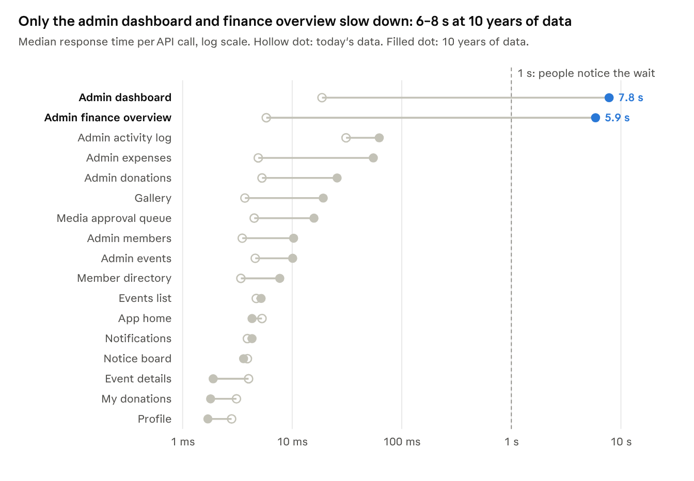

# Society App – Production Readiness & Performance Report

19 Nov 2026 · Online version (editable, with comments): https://claude.ai/artifact/Bbxdc9idDa3z4x1f2JE3RC

## Verdict

**Not ready to deploy yet, but close: the app itself is healthy, light and fast, and five fixes stand between it and production.** Three are deployment steps (move production to PostgreSQL, set `NODE_ENV=production`, make the Android release build) and two are code fixes that only show up with years of data (the dashboard chart query and the admin backup).

| Part | Verdict | Headline numbers |
| --- | --- | --- |
| Mobile app | Healthy and light | 6.4 MB bundle (2.9 MB compressed), screens load on first open, every list paged 10 at a time |
| Backend API | Fast; two admin screens do not scale | 3–31 ms per call today; 495 calls a second for 50 users with no errors; dashboard 7.8 s at 10 years of data |
| Database | Well indexed; backup breaks at scale | Every foreign key indexed; member queries under 25 ms with 2 million notification rows |
| Admin panel | Builds for production | 147–191 KB of JavaScript per page |
| Deployment | Not ready | Production still on MySQL; no Android build config; OTP is fixed at `123456` unless `NODE_ENV=production` |

With the blockers fixed, the measured headroom is about 5–90 times the expected traffic of a 5,000-member society. The go-live checklist below lists every item.

## How it was tested

Every number in this report was measured on 19 Nov 2026 on the development PC, against a copy of the database so live data was never touched.

| Part | What was measured | Tool |
| --- | --- | --- |
| Mobile app | Production JavaScript bundle and bundled files, dependencies, how screens, lists and images load | `npx expo export --platform android` (Expo SDK 58, Hermes) and a code review |
| Backend API | Response time of 17 endpoints (30 calls each) and a 20-second load test with 50 users at once | Node.js script against a second backend started with `NODE_ENV=production` |
| Database | Table sizes, index coverage, query plans of the main lists | PostgreSQL 18 (`EXPLAIN ANALYZE`, catalog queries) |

The API and database were tested twice:

- **Today's size:** 31 users, 17 events, 10 notices, 13 photos, 97 donations, 48 expenses (the demo data).
- **Growth size:** the same copy filled with about 10 years of a large society: 5,000 members, 2,000 events, 5,000 notices, 30,000 photos and videos, 100,000 donations, 20,000 expenses, 2,000,000 notification rows and 200,000 activity-log rows.

Limits: the PC runs the API and database together with no network between them, so real servers add 20–80 ms of network time per call. On-phone start-up time and scrolling smoothness need a release build on a real low-end Android phone (see the checklist).

## Mobile app

The app is light for its size: 39 screens ship in a 6.4 MB Hermes bundle (2.9 MB compressed), screens load only when first opened, and every list loads 10 rows at a time.

| Check | Result | Verdict |
| --- | --- | --- |
| JavaScript bundle (Android, Hermes bytecode) | 6.4 MB, 2.9 MB compressed. Hermes maps it into memory, so start-up does not parse it | Good |
| Bundled files (fonts, images, icons) | 4.4 MB: icon font 1.3 MB, 3 onboarding photos 1.16 MB, app icons 0.8 MB, 7 font files 1.1 MB | Can shrink about 1 MB |
| Dependencies | 34 packages. The heavy ones load only when needed: Excel export (`xlsx`) on first export, the map only on Event Details, the date-range calendar only where used | Good |
| Screen loading | Every screen except Splash is lazy-loaded (`getComponent`): its code runs the first time it opens | Good |
| Lists | 11 list screens use `FlatList` with 8 rows drawn first and a small render window; data is paged 10 at a time (`usePagedList`) and only the newest request may update a list | Good |
| Images | Shown through Cloudinary at the size on screen (`f_auto,q_auto,w_…`); uploads are shrunk to 1600 px JPEG at 70 % before sending | Good |
| Code size | 15,800 lines of TypeScript; type-check clean | Good |

Findings to act on:

- **Onboarding photos** are 360–415 KB each. Saved as WebP at 1080 px they would be about 80 KB each, saving about 0.9 MB of download.
- **Seven font files load before the first screen.** Loading the Gujarati and Hindi fonts only when that language is picked would make the first launch faster on slow phones.
- **Society Expenses** shows its expenses inside a scroll view with a Load More button. That is fine for a month's entries; switch it to `FlatList` if a month ever holds several hundred.

## Backend API

Today every API call answers in 3–31 ms and 50 users at once get 495 requests a second with no errors. With 10 years of data, 15 of 17 calls still answer in under 65 ms; only the admin dashboard and the Financial Overview slow to 6–8 seconds.

*Measured 19 Nov 2026 on the dev PC · 30 calls per endpoint (5 for the two slow ones) · society_perf copy*

| Load test: 50 users for 20 s | Today's data | 10 years of data |
| --- | --- | --- |
| Requests per second | 495 | 268 |
| Median response | 99 ms | 190 ms |
| 95 % of responses within | 134 ms | 297 ms |
| 99 % of responses within | 163 ms | 336 ms |
| Errors | 0 of 9,945 | 0 of 5,419 |

The load mix is what members do most (home, events, notices, gallery, notifications, profile) plus admin lists; the dashboard was measured on its own. Every response is small: the largest page is 8.8 KB, because every list returns 10 rows.

Findings:

- **Dashboard and Financial Overview chart (fix before launch).** The chart runs two sub-queries per month, each scanning every donation or expense: 121 months × 2 scans took 3.2 s in the database alone. Grouping the rows once and joining the months gave the same totals in 0.13 s on the same data.
- **A slow call holds a database connection.** The pool has 10 connections, so 10 dashboard loads at the same time would make every member wait. Fixing the chart query removes this risk.
- **Admin money lists grow with data:** expenses 55 ms and donations 26 ms at 10 years, because each page also adds up its summary cards. Fine for years; see the growth plan.

## Database

The database is well indexed: every foreign key of the 27 tables has an index (97 indexes), and with 10 years of data the member queries still use those indexes and finish in under 25 ms. Two things break as data grows: the dashboard chart query and the admin backup.

| Query (10 years of data) | Time in database | How PostgreSQL runs it | Verdict |
| --- | --- | --- | --- |
| Dashboard / finance chart, all time | 3,222 ms | 2 full table scans for each of 121 months | Fix: group once (126 ms, tested) |
| A member's notifications page | 3 ms | Index on recipient (`idx_recipients_user`) out of 2 million rows | Good |
| Gallery page | 23 ms | Reads all 30,000 items, keeps the newest 10 | Good now; index above ~100,000 items |
| Activity log page | 62 ms (API) | Index on date (`idx_audit_created`) | Good |

| Size | Today | 10 years of data |
| --- | --- | --- |
| Whole database | 11 MB | 312 MB |
| Notification rows (`notification_recipients`) | 43 rows | 2,012,443 rows, 232 MB (74 % of the database) |
| Activity log (`audit_logs`) | 17 rows | 200,017 rows, 33 MB |
| Donations | 97 rows | 100,097 rows, 18 MB |

Findings:

- **Admin backup fails on large data (fix before launch).** App Settings → Backup builds every row as SQL text in server memory and sends it as one response. At 10 years of data it stopped after 2.2 s with an error (`Maximum call stack size exceeded`): it adds a whole table's rows to a list in one call, and the activity log alone has 200,000 rows. Even fixed, one response holding the whole database will not fit a small server's memory. Use the database provider's daily backups as the real backup, and keep the panel export for small tables.
- **Notification rows grow fastest.** Every announcement writes one row per member: 400 announcements to 5,000 members is 2 million rows. Delete or archive read notifications older than 12 months.
- **Connections:** the API uses a pool of 10; PostgreSQL allows 100. That is enough for one API server. Check the hosted plan's connection limit before adding a second server.
- **Dates and money are stored correctly:** money as `NUMERIC(12,2)`, times as `TIMESTAMPTZ`, sessions in Asia/Kolkata, so totals and day boundaries match the app.

## Go-live checklist

Five items block a production launch; eight more should be done before members are invited; three can follow.

### Blockers

- [ ] **Move production to PostgreSQL.** The live server (Render) still uses Aiven MySQL, and the current code only works with PostgreSQL. Set up a hosted PostgreSQL, set `DATABASE_URL`, run `schema.sql` + `seed.sql`, copy the data with `copy_mysql_to_postgres.js`, then deploy.
- [ ] **Fix the dashboard and Financial Overview chart query** (group the rows once instead of two queries per month): 7.8 s → well under 1 s at 10 years of data.
- [ ] **Replace the panel backup** with the database provider's automatic daily backups; fix or limit the panel export (it fails above about 100,000 rows in a table).
- [ ] **Set `NODE_ENV=production` on the server.** Without it every OTP is `123456` and uploads go to the development folder in Cloudinary.
- [ ] **Make the Android release build.** There is no `eas.json` yet; the map needs a Google Maps API key in `app.json`; `EXPO_PUBLIC_API_URL` must point at the https production address.

### Before inviting members

- [ ] **Limit login, OTP and sign-up attempts** per IP and per email (none today): stops password guessing and OTP mail floods.
- [ ] **Add a health-check URL** (for example `GET /api/v1/health` that pings the database) so Render restarts a stuck server.
- [ ] **Turn on gzip** (Render or the `compression` package): JSON shrinks about 70 %, less mobile data.
- [ ] **Add basic security headers** (`helmet`).
- [ ] **Remove unused backend packages**: `sequelize`, `swagger-jsdoc`, `swagger-ui-express`, `moment`; move `nodemon` to dev dependencies.
- [ ] **Move the last files out of `backend/uploads/`** (1 profile photo, 3 event posters) to Cloudinary: Render wipes its disk on every deploy.
- [ ] **Test a release build on a low-end Android phone**: start-up time and scrolling are the one thing this report could not measure.
- [ ] **Schedule a clean-up of read notifications older than 12 months.**

### Can follow after launch

- [ ] Shrink the three onboarding photos (WebP) and load the Gujarati / Hindi fonts only when picked (about 1 MB smaller app).
- [ ] Push notifications (FCM) and online payments (Razorpay): new features, not launch blockers.
- [ ] Response-time alerts on the server (for example any call over 1 s).

## Growth plan

One API server has plenty of room: 5,000 members opening the app 5 times a day is about 3 calls a second on average and perhaps 50 a second on a festival night, against 268 calls a second measured with 10 years of data. A small cloud server has less CPU than the test PC, so repeat the load test on the real server after deploying.

Watch these numbers and act when one crosses its line:

| What grows | Act when | What to do |
| --- | --- | --- |
| Admin dashboard and Financial Overview | Now (6–8 s at 10 years of data) | Group the chart rows once (blocker above) |
| Notification rows | Over 1 million rows or 200 MB | Monthly job deleting read notifications older than 12 months |
| Gallery items | Over 100,000 items, or the gallery page over 100 ms | Add an index on approved items by date |
| Activity log | Over 1 million rows | Keep 2 years in the table, export older rows |
| Admin donation and expense lists | A page over 200 ms | Keep monthly totals in a small summary table instead of adding up every row |
| API traffic | 95 % of calls over 500 ms, or server CPU over 70 % | Bigger server first. A second server also needs: the daily job on one server only, the settings cache cleared on every server, and 10 more database connections |
| Database connections | Over 80 % of the plan's limit | Connection pooler (PgBouncer, usually offered by the provider) |
| Mobile app size | Bundle over 10 MB, or start-up over 3 s on a low-end phone | Load fonts on demand, review new packages before adding them |

Rules that keep it fast as the app grows:

- Every list stays paged at 10–50 rows (already the rule in CLAUDE.md); never return a whole table.
- Totals for cards and charts are added up by the database in one grouped query, never one query per month or per row.
- New list filters get an index when the table can pass 100,000 rows.
- Images always go through Cloudinary at the size shown on screen; uploads stay compressed on the phone.

## Appendix: re-running the tests

Re-run these after each big change and after deploying, and compare with the numbers above.

1. **App size:** in `frontend/mobile`, run `npx expo export --platform android --output-dir dist-check` and read the `.hbc` file size (6.4 MB today).
2. **Admin panel size:** in `frontend/admin`, run `npx next build`; each page's "First Load JS" was 147–191 KB.
3. **Growth copy of the database:** create `society_perf` from a `pg_dump` of `society_app`, then run the growth-data script (5,000 members, 100,000 donations, 2 million notification rows; about 3 minutes). The script refuses to run on any other database.
4. **Test API server:** in `backend`, start `node server.js` with `NODE_ENV=production PORT=5021 DB_NAME=society_perf` and mail turned off.
5. **Load test:** run the load-test script against `http://localhost:5021/api/v1`; it logs in as a member and the Super Admin, times 17 calls, then runs 50 users for 20 seconds.
6. **Query plans:** run `EXPLAIN (ANALYZE)` on the chart, gallery and notification queries in `society_perf`.

The load-test, growth-data and query-plan scripts were run from a temporary folder for this report; keep them under `backend/perf/` if the tests should be repeatable by the team. Drop `society_perf` when done: it is a test copy (312 MB) with a changed Super Admin password.
